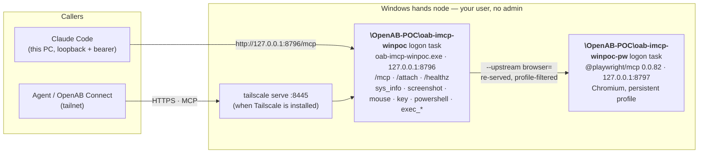

# Windows hands node setup (POC)

How to turn a Windows 10/11 desktop into a hands node with the Rust PoC in
[`poc/reverse-attach-linux/`](../poc/reverse-attach-linux/) (the same crate as Linux, Windows
platform layer). One step: clone the repo and double-click `scripts\setup-winpoc.cmd`. No admin,
no Rust, no MSVC, no `gh`.

This is a **POC**. Every outward name (exe, Scheduled Tasks, folders, ports, the Claude Code
server name) is a POC name that does not collide with a future release, pending the author's
confirmation; the tool names (`sys_info`, `screenshot`, `mouse`, `key`, `powershell`,
`exec_*`, `browser_*`) are the real contract. Builds are unsigned.

Read the trust warning at the top of the [README](../README.md) first. On Windows, `powershell`
is offered to whoever can attach this node: they get a shell as the signed-in user.

## What you end up with



Two Scheduled Tasks that start at every sign-in (the Windows counterpart of a LaunchAgent or a
systemd user unit), both on loopback only. The Playwright port is never exposed; only the node
re-serves it.

| What | Where |
|---|---|
| Program | `%LOCALAPPDATA%\Programs\OpenAB-POC\imcp-winpoc\` (exe, `install-winpoc.ps1`, `pw-mcp.ps1`) |
| Token, grants, logs | `%LOCALAPPDATA%\oab-imcp-winpoc\` (owner + SYSTEM only) |
| Browser pieces | `%LOCALAPPDATA%\oab-imcp-winpoc\pw-mcp`, `pw-profile`, `pw-output` |
| Ports | node 8796, Playwright 8797, `tailscale serve` 8445 |
| Claude Code server | `oab-imcp-winpoc`, user scope |

## Prerequisites

- Windows 10 or 11, x64, signed in to a desktop session (the tools drive that desktop).
- Optional: [Node.js](https://nodejs.org) LTS for the browser tools. Without it, everything
  else installs and the summary tells you to re-run setup after installing Node.js.
- Optional: [Claude Code](https://docs.claude.com/en/docs/claude-code) (`claude` on PATH) to
  have the node registered for you.
- Optional: [Tailscale](https://tailscale.com/download/windows) for access from other machines.
  Setup then runs `tailscale serve` and prints an `https://<host>.<tailnet>.ts.net:8445/mcp` URL.

## 1. Install

```powershell
git clone https://github.com/pro5251/instance-mcp
```

Then **double-click `scripts\setup-winpoc.cmd`**. It:

1. Finds the newest `winpoc-v*` release on GitHub, downloads
   `oab-imcp-winpoc-<ver>-windows-amd64.zip` and its `.sha256`, checks the hash, removes the
   "downloaded from the internet" mark and unpacks it to `%TEMP%\oab-imcp-winpoc-setup`.
2. Runs `install-winpoc.ps1` **from that ZIP**, so the installer and the exe are the same
   version. The installer copies the program, creates or keeps the bearer token, registers the
   logon task, starts it, waits for `/healthz` = `ok`, and runs `tailscale serve` when Tailscale
   is present.
3. With Node.js: `npm install --save-exact @playwright/mcp@0.0.82` (the macOS/Linux pin) and
   `playwright install chromium`, a second logon task for it, and `--upstream
   browser=http://127.0.0.1:8797/mcp` on the node. Any failure here is a warning only.
4. With Claude Code: registers the node (see [Claude Code](#3-claude-code)); without it, prints
   the command to paste later.
5. Prints a summary:

```text
================ ready ================
  MCP URL : http://127.0.0.1:8796/mcp
  token   : 3f9c…  (also at C:\Users\you\AppData\Local\oab-imcp-winpoc\token)
  autostart: logon task \OpenAB-POC\oab-imcp-winpoc (runs now and every sign-in)
  browser : browser_* via Playwright MCP on 127.0.0.1:8797 (task \OpenAB-POC\oab-imcp-winpoc-pw)
  Claude Code: registered 'oab-imcp-winpoc' (user scope, http://127.0.0.1:8796/mcp)
               note: the token is stored in plain text in Claude Code's user config (~\.claude.json)
======================================
```

From a shell, run the script itself (the `.cmd` waits for a key press at the end):

```powershell
powershell -NoProfile -ExecutionPolicy Bypass -File scripts\setup-winpoc.ps1 [options]
```

### Options

`setup-winpoc.ps1` handles the first four; everything else goes to `install-winpoc.ps1`.

| Option | Effect |
|---|---|
| `-Version <tag>` | Install that release (`winpoc-v0.0.1` or `0.0.1`) instead of the newest; use it to roll back |
| `-ZipPath <zip>` | Install a ZIP you already have: no download, **no hash check** (offline, rate limited) |
| `-Repo <owner/name>` | Take releases from another repo (default `pro5251/instance-mcp`) |
| `-ApiBase <url>` | GitHub API base URL (tests point it at a local fake) |
| `-NoBrowser` | Skip the browser tools (no Chromium download) |
| `-NoClaudeCode` | Do not touch Claude Code (manage the client yourself) |
| `-Token <str>` | Bearer token for a first install (default: generate one). An existing token is always kept; `-Uninstall -Purge` first to change it |
| `-AllowLogin <email>` | Tailscale identity instead of a token; Claude Code is then not registered |
| `-SkipTailscale` | Do not run `tailscale serve` |
| `-Uninstall [-Purge]` | Remove (see [Uninstall](#uninstall)) |
| `-Status` | Show both tasks and whether program/data are present |

Draft releases and tags that do not start with `winpoc-v` are ignored. The exit code is the
installer's: `0` installed, non-zero failed (`2` no such release, `3` hash mismatch, `4`
download/API failure, `1` installer error).

## 2. Verify

```powershell
curl.exe -s http://127.0.0.1:8796/healthz                                   # ok
$t = (Get-Content "$env:LOCALAPPDATA\oab-imcp-winpoc\token").Trim()
(Invoke-RestMethod -Method Post http://127.0.0.1:8796/mcp -Headers @{ Authorization = "Bearer $t" } `
  -ContentType application/json -Body '{"jsonrpc":"2.0","id":1,"method":"tools/list"}').result.tools.name
claude mcp list                                                             # oab-imcp-winpoc: … ✓ Connected
```

Expect 9 local tools (`sys_info`, `screenshot`, `mouse`, `key`, `powershell`, `exec_start`,
`exec_poll`, `exec_list`, `exec_cancel`) plus `browser_*` when the browser tools are set up.

## 3. Claude Code

Setup applies the README's client pattern (`mcp add … --header "Authorization: Bearer …"`) to Claude Code on this PC:

```powershell
claude mcp remove --scope user oab-imcp-winpoc          # errors ignored: re-runs replace, never duplicate
claude mcp add --transport http --scope user oab-imcp-winpoc http://127.0.0.1:8796/mcp `
  --header "Authorization: Bearer <token>"
claude mcp get oab-imcp-winpoc                          # a failed check only warns
```

- **User scope**: the tools are available in every project directory.
- **Loopback + bearer**: no TLS needed on the same machine. With `-AllowLogin` there is no token
  and a loopback request carries no Tailscale identity, so setup does not register and says why;
  register the `https://…ts.net:8445/mcp` URL by hand instead.
- **Security boundary**: the token is stored in **plain text** in Claude Code's user config
  (`~\.claude.json`). Anyone who can read that file can drive this desktop through the node.
  Uninstall removes the entry; `-Purge` also deletes the token itself.
- No Claude Code yet: the summary prints the exact `claude mcp add …` line to paste once it is
  installed. Other clients (Claude Desktop, OpenAB Connect) are not registered by setup; point
  them at the printed URL with the token.

## 4. Browser tools

With Node.js on PATH, setup installs `@playwright/mcp@0.0.82` under
`%LOCALAPPDATA%\oab-imcp-winpoc\pw-mcp` and Playwright's Chromium (shared cache in
`%LOCALAPPDATA%\ms-playwright`), and registers `\OpenAB-POC\oab-imcp-winpoc-pw`, which runs
`pw-mcp.ps1` in a hidden PowerShell. The browser is headed on your desktop with a persistent
profile in `pw-profile`. The node starts with `--upstream browser=http://127.0.0.1:8797/mcp` (a
flag, because a Scheduled Task does not inherit environment variables). The install log is
`%LOCALAPPDATA%\oab-imcp-winpoc\logs\pw-install.log`.

Installed Node.js after the node? Re-run setup.

## Update

Re-run `scripts\setup-winpoc.cmd`. It installs the newest release in place (stops both tasks
first, so the exe can be replaced) and keeps the token, so clients keep working. `-Version`
installs an older one.

## Uninstall

```powershell
powershell -NoProfile -ExecutionPolicy Bypass -File scripts\setup-winpoc.ps1 -Uninstall          # keep token/grants
powershell -NoProfile -ExecutionPolicy Bypass -File scripts\setup-winpoc.ps1 -Uninstall -Purge   # delete everything
```

Uninstall stops and removes both tasks, the program folder and the Claude Code registration.
`-Purge` also deletes `%LOCALAPPDATA%\oab-imcp-winpoc` (token, grants, logs, the Playwright
install, browser profile and output). Offline, the installed copy does the same:
`%LOCALAPPDATA%\Programs\OpenAB-POC\imcp-winpoc\install-winpoc.ps1 -Uninstall [-Purge]`.
Playwright's shared Chromium cache (`%LOCALAPPDATA%\ms-playwright`) is left alone.

## Install with an AI agent

Steps an agent (for example Claude Code itself) can follow on the target PC, in PowerShell,
from the repo root. Each step has a check; stop at the first that fails and use the table below.

1. Run setup non-interactively:

   ```powershell
   powershell -NoProfile -ExecutionPolicy Bypass -File scripts\setup-winpoc.ps1
   echo "exit=$LASTEXITCODE"
   ```

   Success: `exit=0` and the output ends with the `==== ready ====` summary.
2. Health: `curl.exe -s http://127.0.0.1:8796/healthz` prints `ok`.
3. Claude Code: `claude mcp list` shows `oab-imcp-winpoc` … `Connected` (skip if the summary
   said Claude Code was not found or skipped).
4. Browser (if Node.js is installed): the summary's `browser :` line says `browser_* via
   Playwright MCP`, and `tools/list` from [Verify](#2-verify) contains `browser_navigate`.

| Symptom | Cause | Do this |
|---|---|---|
| `cannot list releases … rate limit` / `HTTP 403` | GitHub API allows 60 unauthenticated calls per hour per IP | Wait an hour, or download the ZIP from the Releases page and run with `-ZipPath <zip>` |
| `no winpoc-v* release found` | The repo has not published one | Pass `-Repo <owner/name>` of a repo that has, or `-ZipPath` |
| `release winpoc-v… not found` | Typo, or a draft | Pick one of the listed tags |
| `sha256 mismatch` | Truncated or altered download; nothing was installed and the file is deleted | Retry once; if it repeats, do not install that file, report it |
| `browser : skipped - Node.js not found` | No `node`/`npm` on PATH | Install Node.js LTS, open a new shell, re-run setup |
| `browser : FAILED …` | npm or the Chromium download failed (proxy, disk) | Read `logs\pw-install.log`; core tools work regardless; re-run setup |
| `Claude Code: not found` | No `claude` on PATH | Install Claude Code, then paste the printed `claude mcp add …` line |
| `claude mcp list` shows `Failed to connect` | Node not running | `-Status`; re-run setup; logs in `%LOCALAPPDATA%\oab-imcp-winpoc\logs` |
| `node did not become healthy` | Port 8796 taken, or the exe was blocked | `netstat -ano \| findstr 8796`; check SmartScreen / Smart App Control below |
| SmartScreen "Windows protected your PC", or the exe does not start | Unsigned POC build | **More info → Run anyway**, or allow it in Windows Security; Smart App Control may need to be off. Code signing is the author's release decision |

## Gotchas

- **Windows PowerShell started from a PowerShell 7 prompt** inherits pwsh's module path and
  cannot load `Get-FileHash` / `ScheduledTasks`; both scripts drop pwsh's module folders from
  `PSModulePath` first.
- **The `.cmd` pauses at the end** so a double-click window stays open; agents and scripts
  should call `setup-winpoc.ps1` directly.
- **A Scheduled Task's PATH may lack Node.js** (nvm, Volta): the Playwright task passes the
  folder `node.exe` was found in at install time.

## For maintainers: publishing a release

The fork-only workflow [`.github/workflows/winpoc-release.yml`](../.github/workflows/winpoc-release.yml)
builds the exe with MSVC and a static CRT (no VC runtime needed), packs the ZIP exactly like
`release.yml`'s `windows` job and publishes it as a prerelease. Normal pushes never release:

```sh
git tag winpoc-v0.0.1 && git push origin winpoc-v0.0.1
# retry: gh workflow run winpoc-release.yml --ref winpoc-v0.0.1 -f tag=winpoc-v0.0.1
```

The default repo lives in one place, the variables block at the top of
`scripts/setup-winpoc.ps1`. For an upstream PR: set it to `openabdev/instance-mcp` (and the
clone URL and `-Repo` default in this guide), and leave `winpoc-release.yml` out (upstream ships the ZIP from `release.yml`).

Smoke tests (from WSL, real desktop): `poc/reverse-attach-linux/windows/smoke_setup.sh`
(release selection, `-Version`, hash mismatch, errors, `-ZipPath`) and `smoke_install.sh`
(install, browser, Claude Code via a stub, re-run, opt-outs, uninstall), both through
`setup-winpoc.ps1 -ApiBase` against `mock_github.py`; `run-all-smokes.sh` runs everything.
